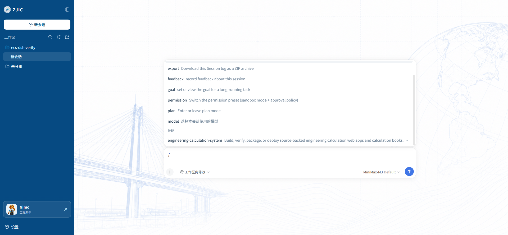

# Engineering Calculation System for DeepSeek Harness

NIMO Engineering / skill pack `0.0.1` is a local preview and has not been
formally released. Its product version was intentionally reset from historical
`2.6.0`. Existing `2.6.0` users must manually install the verified `0.0.1` preview
and matching host adapter; version comparison and automatic updates cannot
perform this migration. Preserve configuration, business data, and the `2.6.0`
rollback package. Host adapter package versions may be independent of the skill pack.

This package is the DeepSeek Harness bundle for the Engineering Calculation
System skill pack. Installing it into a profile publishes one skill named
`engineering-calculation-system` to every session in that profile, without
copying anything into a user skill directory.

## What the package contains

| Path | Role |
|---|---|
| `package.json` | Bundle manifest: `dsh.bundle.patch` names the composition layer this package contributes. |
| `cordis.patch.yml` | The layer: one row that mounts this package's Cordis plugin. |
| `lib/index.js` | The plugin: registers a `ctx.skills` provider that serves the shipped skill. |
| `skills/engineering-calculation-system/` | The bundled skill: the complete pack, including `SKILL.md`, the router and lifecycle skills, shared contracts, templates, schemas, scripts, and the project scaffold. |
| `overlays/engineering-calculation-system/shared/dsh-plugin-adapter.md` | DSH-specific guidance applied over the core pack at sync time. |
| `scripts/sync_from_core.py` | Refreshes the bundled skill from the source core package and reapplies the overlay. |
| `scripts/validate_plugin.py` | Validates the wrapper, the bundled frontmatter, every referenced bundle path, references to trees the bundle does not carry, and stray build residue. |
| `scripts/install-into-local-client.ps1` | Installs, inspects, and removes the bundle in an installed DeepSeek Harness client. |
| `tests/provider.test.mjs` | Contract tests for the packaged provider: catalog fields, body reload, resource base, and the failure paths. |
| `docs/ADAPTATION.md` | Why the pack is distributed as a DeepSeek Harness bundle and what stays platform-neutral. |
| `docs/LOCAL_CLIENT_INSTALL.md` | Install, verify, and uninstall steps for the local client. |

## Install

Any DeepSeek Harness profile accepts the package through the plugin manager, which
forwards to the `pnpm` on your `PATH`:

```sh
dsh plugin --profile web add /absolute/path/to/engineering-calculation-system-dsh
```

The command installs the package into the profile (a `file:` install snapshots
the directory), appends the bundle to `dsh.profile.bundles`, and mounts the layer
at the next boot. Verify the layer without booting a session:

```sh
dsh --profile web --dump-config
```

The dump lists a `# == @engineering-calculation-system/dsh-plugin` layer and its
`engineering-calculation-system` row. On an installed client, run
`Manage Web Plugins.cmd` instead of the bare `dsh` command; see
[docs/LOCAL_CLIENT_INSTALL.md](docs/LOCAL_CLIENT_INSTALL.md). The client's `/`
menu then lists the skill under its skills section:



## How the skill reaches a session

The mounted plugin registers one provider on `ctx.skills`. Discovery reads the
frontmatter of `skills/<name>/SKILL.md` into a catalog entry, and every load
re-reads the file, so editing a body changes later loads without a version bump.
The loaded result carries a directory resource base — the bundle directory — and
the model resolves the pack's relative paths against it.

Notes for operators:

- The catalog renders a capped description; the full description stays in the
  loaded body and in `SKILL.md`.
- Sessions read the bundle directly from the installed package. Reading outside
  the workspace is permitted; writes stay confined to the session workspace, so
  generated projects belong in the workspace rather than beside the bundle.
- A package that ships no readable `SKILL.md` fails at load with the packaged
  path in the error instead of publishing an empty catalog.

## Maintain

```sh
python scripts/sync_from_core.py --dry-run   # preview the refresh
python scripts/sync_from_core.py             # refresh, then validate
python scripts/sync_from_core.py --force     # allow overwriting uncommitted drift
python scripts/validate_plugin.py            # validate only
node --test tests/provider.test.mjs          # provider contract tests
```

The sync stages `engineering-calculation-system/core/engineering-calculation-system`,
applies `overlays/`, drops the core's Codex-only adapter section, inserts the DSH
adapter section, and validates the result. The Codex and ZCode plugins keep their
own overlays; this package never edits the core package.

## License

UNLICENSED — distribution follows the skill pack's own terms.
